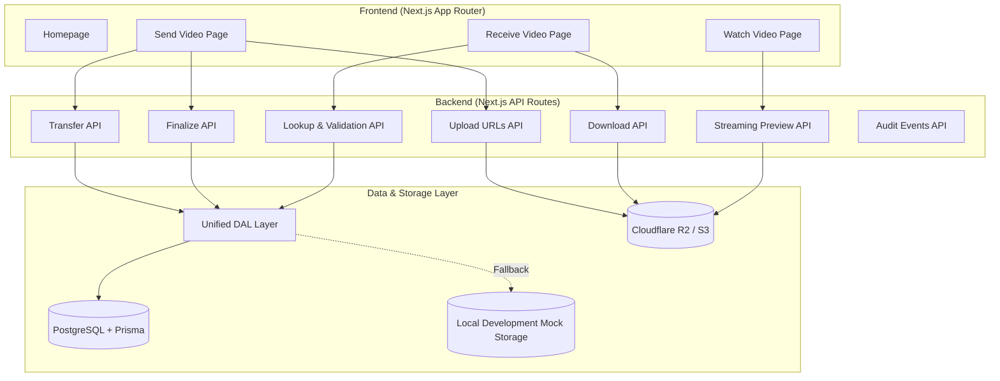

# VIDELINK — Implementation Plan

## Architecture Overview

## Phase 1: Project Foundation
- [x] Initialize Next.js with TypeScript, Tailwind, App Router
- [x] Install dependencies (Prisma, Zod, AWS S3 SDK, bcryptjs, qrcode, lucide-react)
- [x] Create `.env.example` and `.env.local`
- [x] Set up design system (theme, colors, typography, glassmorphism, glowing badges)
- [x] Create shared layout, navigation, theme toggle

## Phase 2: Frontend Pages
- [x] Homepage (hero, benefits, how-it-works, FAQ, footer)
- [x] Send Video page (file select → settings → upload → code & QR code display)
- [x] Receive Video page (code input → validation → details → download/watch)
- [x] Watch Video Streaming Player page with cinema viewer, controls, and passport
- [x] Error states, loading spinners, and empty states

## Phase 3: Database & Backend APIs
- [x] Prisma schema (Transfer, UploadSession, TransferEvent, User)
- [x] Resilient Data Access Layer (Prisma PostgreSQL with automatic local persistence fallback)
- [x] Transfer creation API (`POST /api/transfers`)
- [x] Transfer code generation (crypto-secure `VL-XXXX-XXXX` format, collision-safe)
- [x] Code lookup with rate limiting (`POST /api/transfers/lookup`)
- [x] Password hashing with bcrypt
- [x] Input validation with Zod schemas

## Phase 4: Cloudflare R2 & Storage Integration
- [x] S3-compatible client configuration for Cloudflare R2
- [x] Multipart upload initiation
- [x] Presigned URL generation for parts (`POST /api/transfers/[id]/upload-urls`)
- [x] Multipart upload completion (`POST /api/transfers/[id]/finalize`)
- [x] Presigned original download URLs (`POST /api/transfers/download`)
- [x] Abort/cleanup for abandoned uploads (`POST /api/transfers/[id]/abort`)
- [x] Seamless local development mock storage adapter for zero-friction testing

## Phase 5: Upload Workflow
- [x] Client-side multipart chunking (10MB parts)
- [x] Concurrent part uploads with bounded parallelism
- [x] Real-time progress tracking (percentage, speed, ETA, part counter)
- [x] Retry with exponential backoff + jitter
- [x] Upload abort and cancellation support
- [x] SHA-256 client integrity verification

## Phase 6: Transfer Security
- [x] Secure code generation (VL-XXXX-XXXX format)
- [x] HMAC-SHA256 code hashing for DB lookup
- [x] Optional password protection with bcrypt
- [x] Download limit enforcement
- [x] Expiration enforcement
- [x] Rate limiting on code lookups and downloads
- [x] Filename sanitization against path traversal

## Phase 7: Download Workflow
- [x] Presigned download URL generation
- [x] Original filename preservation with Content-Disposition
- [x] Download event tracking
- [x] Download count enforcement

## Phase 8: Preview & Playback
- [x] Browser-compatible video detection
- [x] Streaming playback via presigned preview URL
- [x] HTTP 206 Partial Content range requests for smooth video scrubbing
- [x] Dedicated cinema player `/watch/[code]` with passport and download button

## Phase 9: Advanced Features
- [x] Dynamic QR code generation with image download
- [x] Transfer activity audit log (`GET /api/transfers/[id]/events`)
- [x] Transfer passport metadata view

## Phase 10: Testing & Verification
- [x] Automated end-to-end integration test suite (`scripts/test-transfers.mjs`)
- [x] Full production Next.js build validation (`npm run build`)
- [x] Browser subagent UI navigation & screenshots
